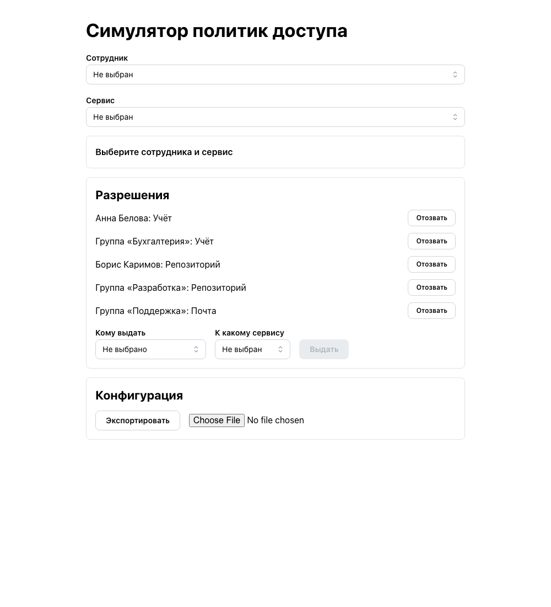
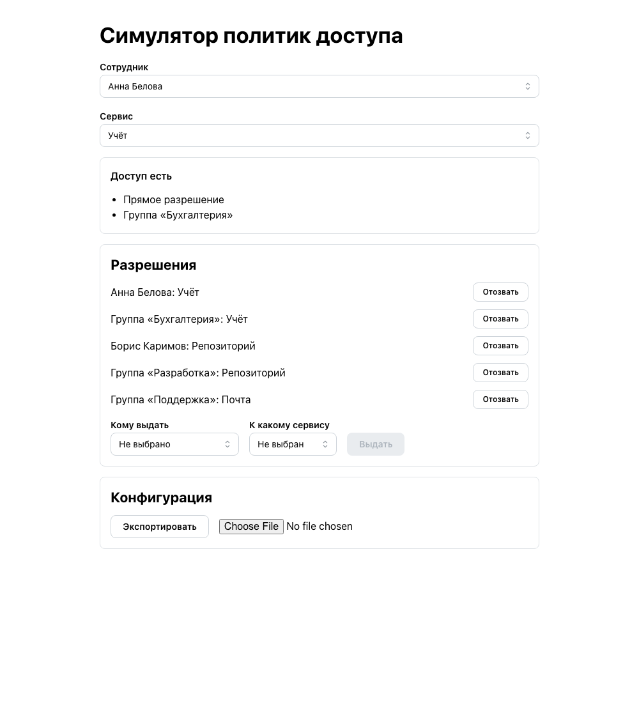
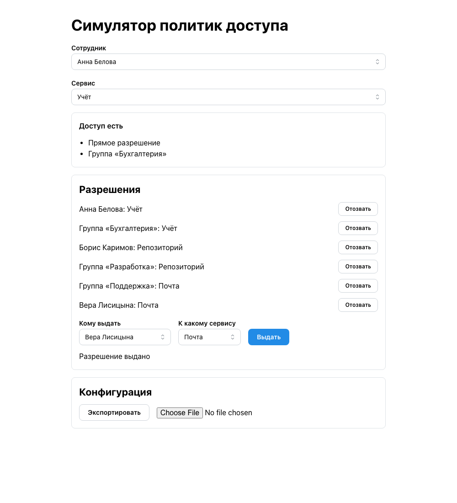
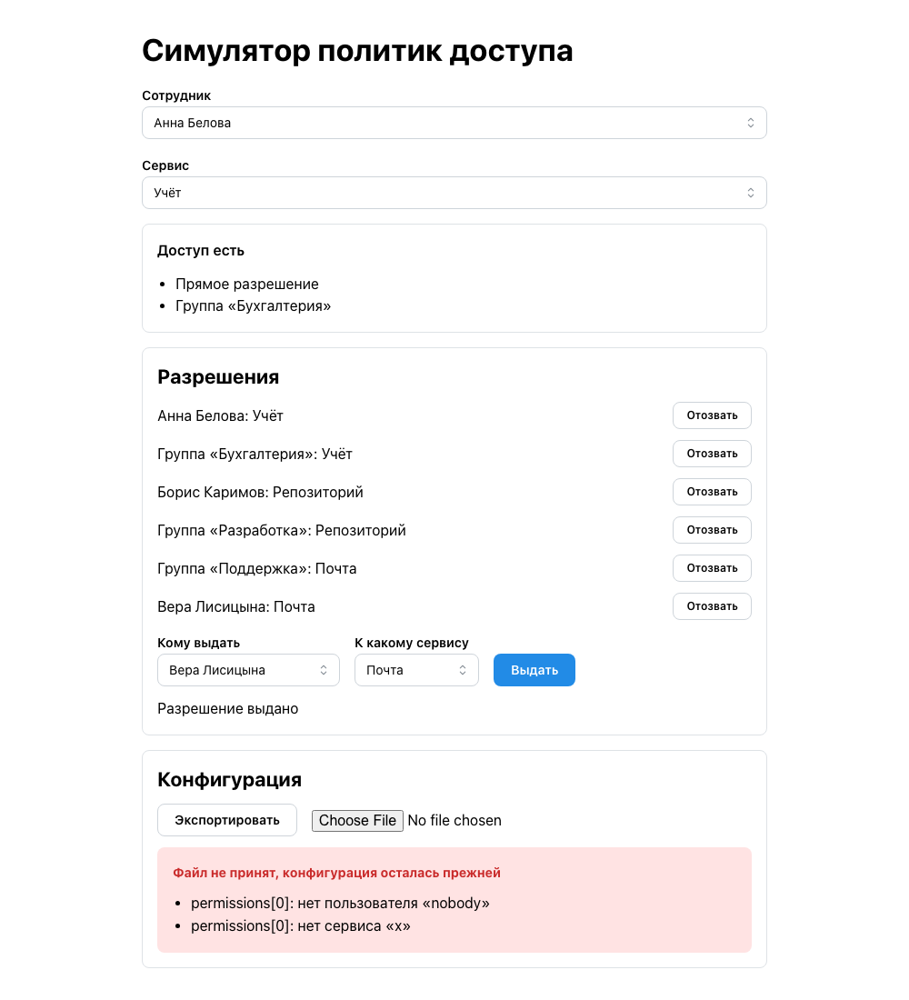

# Симулятор политик доступа

Демонстрация учебного проекта «Симулятор политик доступа» из курса AI SDLC на Хекслете. Симулятор показывает, к каким сервисам получит доступ сотрудник по прямым и групповым разрешениям. Студент получает готовое приложение и проводит через агентный процесс шесть изменений: от внедрения OpenSpec до разбора инцидента и улучшения процесса.

Симулятор работает на учебных данных и не управляет доступом к реальным сервисам.

## Экраны готового приложения

Главный экран до выбора сотрудника и сервиса.

Результат расчёта для сотрудника и сервиса. Приложение называет источники доступа, прямое разрешение и разрешение группы.

Панель разрешений. Выдача нового разрешения подтверждается сообщением.

Импорт конфигурации. Файл проверяется целиком, и при ошибках приложение показывает все причины отказа и не меняет данные.

